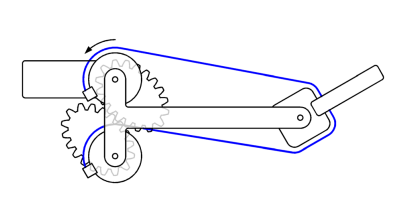
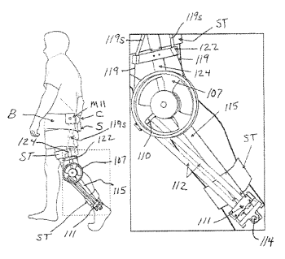

```{=latex}
\goststruct{ПЕРЕЧЕНЬ СОКРАЩЕНИЙ И ОБОЗНАЧЕНИЙ}
```

В настоящей работе применяются следующие обозначения и сокращения:

БПЛА – беспилотный летательный аппарат;

ТПР – тросовый параллельный робот;

DVRA – Double-Vane Rotary Actuator (двухлопастной роторный гидравлический привод);

DoF – Degree of Freedom (степень свободы);

LVDT – Linear Variable Differential Transformer (линейный дифференциально-трансформаторный датчик);

PID – Proportional-Integral-Derivative (пропорционально-интегрально-дифференциальный регулятор);

RVDT – Rotary Variable Differential Transformer (вращающийся дифференциально-трансформаторный датчик),

TDA – Tension Distribution Algorithm.

```{=latex}
\clearpage
\setcounter{tocdepth}{2}
{\centering СОДЕРЖАНИЕ\par}
\vspace{6pt}
\renewcommand{\contentsname}{}
\tableofcontents
\clearpage
```

```{=latex}
\goststruct{ВВЕДЕНИЕ}
```

В современной робототехнике всё большее значение приобретают задающие манипуляторы – устройства, предназначенные для воспроизведения точной тактильной и силовой обратной связи в реальном времени. Такие системы широко используются в медицине (хирургические симуляторы, реабилитационные устройства), виртуальной и дополненной реальности, телеробототехнике, а также в промышленных симуляторах. Ключевым элементом, определяющим качество работы задающего манипулятора, является тип привода, от которого зависят такие параметры, как прозрачность взаимодействия, обратимость, точность воспроизведения усилия, динамические характеристики и надёжность.

Среди различных архитектур приводов особое внимание в последние годы уделяется тросовым (кабельным) системам, обладающим рядом уникальных преимуществ: низкой инерцией, отсутствием люфтов, возможностью разнесённого размещения приводных двигателей и высокой обратимостью. Однако применение тросовых систем сопряжено и с рядом сложностей – необходимостью поддержания постоянного натяжения, чувствительностью к удлинению и износу кабелей, а также ограничениями по жёсткости механической передачи.

Целью настоящей работы является исследование зависимости выбора и настройки алгоритмов управления системой силовой обратной связи задающего манипулятора от фундаментальных механических характеристик тросовой передачи, таких как продольная упругость, трение в элементах трассировки и явление прослабления троса.

Для достижения поставленной цели решаются следующие задачи:

– систематизировать механические нелинейности тросовых систем, критически влияющие на динамику контура обратной связи;

– провести классификацию алгоритмов управления, применяемых для компенсации специфических нелинейностей тросовых приводов;

– выполнить теоретический анализ влияния параметров жесткости и трения тросовой системы на устойчивость и качество переходных процессов в контуре управления;

– оценить влияние податливости механических опор направляющих роликов на динамику распределенных тросовых систем с длинными трассами и сформулировать требования к аппаратно-программной компенсации паразитных резонансов;

– сформулировать рекомендации по выбору структуры регулятора в зависимости от доминирующего механического фактора тросовой системы.

```{=latex}
\clearpage
```

# 1 Теоретические основы тросовых приводных систем

## 1.1 Принцип действия тросовых и основные компоненты тросовых приводов

Тросовые приводы (также известные как кабельные или тенонные приводы) представляют собой тип механической передачи, в которой усилие передаётся через гибкие элементы – тросы или кабели, работающие исключительно на растяжение [@ref1]. Такие приводы широко применяются в робототехнике, особенно в устройствах, требующих компактности, низкой инерции и высокой скорости перемещения исполнительных органов. Типичными областями применения являются хирургические манипуляторы, мягкие роботы, эндоскопы, а также крупногабаритные параллельные роботы с большой рабочей зоной [@ref2].

Принцип действия тросового привода основан на передаче силы от приводного элемента (например, электродвигателя с барабаном или шкивом) к рабочему органу через натянутый трос. В большинстве случаев для двустороннего управления одним сочленением (например, сгибание/разгибание) используется пара тросов – так называемая pull–pull (тяни–тяни) конфигурация, аналогичная схеме действия антагонистических мышц у животных [@ref3]. При этом, когда один трос натягивается для создания движения в одну сторону, второй трос ослабляется, и наоборот. Ключевой проблемой такой схемы является поддержание постоянного натяжения в тросах во всём диапазоне перемещений, поскольку прослабление приводит к потере точности позиционирования и возникновению гистерезиса [@ref1].

Для обеспечения надёжной передачи движения без проскальзывания и потери натяжения в тросовых приводах применяются различные конструктивные решения. Наиболее распространёнными являются:

– круглые шкивы и барабаны – простейший вариант, однако при использовании с нециркулярными сочленениями приводит к изменению натяжения и возможному ослаблению троса [@ref1];

– некруглые шкивы или зубчатые колёса – позволяют реализовать нелинейную связь между углом поворота привода и длиной вытягивания троса, что особенно важно для сочленений с нецилиндрической геометрией (например, шарниры без шкивов или роликовые сочленения) [@ref1];

– пластичные или жёсткие структуры корпуса робота, такие как гидростатические или мышечные гидростаты, в которых тросы интегрированы в мягкую оболочку, имитирующую биологические ткани [@ref2];

– системы предварительного натяжения, включая пружины, эластичные элементы или дополнительные активные приводы, для компенсации ослабления троса [@ref1].

Таким образом, основные компоненты тросового привода включают:

– приводной двигатель (обычно шаговый или бесщёточный электродвигатель);

– барабан или шкив, на который наматывается трос;

– гибкий трос, чаще всего из нержавеющей или вольфрамовой стали, с высокой продольной жёсткостью и гибкостью на изгиб [@ref1];

– датчики силы или энкодеры, для измерения натяжения и положения [@ref4];

– направляющие ролики или шкивы, обеспечивающие правильную трассировку троса (при этом в крупногабаритных системах с длинными трассами жесткость их крепежных кронштейнов и подшипниковых узлов начинает выступать как дополнительный паразитный упругий элемент, сопоставимый с продольной упругостью самого троса);

– механизмы регулировки натяжения или компенсации удлинения, особенно важные при использовании эластичных или мягких структур [@ref1], [@ref2].

```{=latex}
\vspace{12pt}
```

## 1.2 Классификация тросовых приводов и области их применения

Тросовые приводы находят применение в широком спектре робототехнических. В зависимости от архитектуры кинематической цепи, они подразделяются на последовательные, параллельные и смешанные (гибридные) тросовые системы [@ref1], [@ref4].

### 1.2.1 Последовательные тросовые приводы

Последовательные тросовые манипуляторы характеризуются серийной структурой звеньев, где тросы проходят сквозь все сегменты, последовательно воздействуя на каждый из них. Такие системы отличаются высокой степенью подвижности и компактностью, но страдают от накопленных ошибок позиционирования и ограниченной жёсткости. Особенно актуальны они в области мягкой робототехники, где тросы используются как искусственные сухожилия, управляющие гибкими или эластичными суставами.

Примером служит мягкий роботизированный сустав с парой некруглых шкивов в работе Suh и Kim [@ref1], представленный [на рисунке 1](#fig:1).

```{=latex}
\phantomsection\label{fig:1}
```

![Рисунок 1 – Конфигурация изгибаемого соединения, приводимого в действие тросовым приводом [1]](media/fig1.png){width=14.13cm}

Эта система, представленная [на рисунке 2](#fig:2), использует антагонистическую пару тросов, наматываемых на специальные некруглые шкивы, что обеспечивает согласованное сгибание/разгибание без люфтов и с минимальным расслаблением тросов. Механизм имитирует биомеханику мышц человека и позволяет добиться высокой плавности и точности движения даже в мягких конструкциях, где традиционные приводы неприменимы.

{width=10.68cm}

```{=latex}
\phantomsection\label{fig:2}
```

![Рисунок 2 – Механизм тросового привода с использованием пары некруглых шестерен или шкивов [1]](media/fig3.png){width=8.11cm}

Другой пример – это многозвенный манипулятор типа «хобот», описанный Мокаевой и коллегами [@ref5]. В нём тросы проходят через крепёжные точки всех сегментов и управляют изгибом по всей длине, обеспечивая реализацию сложных пространственных траекторий («вогнутый конус», «выпуклая бочка» и др.). Экспериментальный стенд с манипулятором представлен [на рисунке 3](#fig:3).

```{=latex}
\phantomsection\label{fig:3}
```

![Рисунок 3 – Экспериментальный стенд для определения кинематических и динамических характеристик многозвенного манипулятора с тросовым управлением [5]](media/fig4.png){width=15.16cm}

Такие манипуляторы находят применение в сельском хозяйстве (деликатная сборка урожая) и медицинской эндоскопии [@ref5].

### 1.2.2 Параллельные тросовые приводы

Параллельные тросовые роботы (ТПР) состоят из неподвижной базы, подвижной платформы и нескольких тросов, соединяющих их напрямую. Такие схемы обеспечивают высокую жёсткость, точность, грузоподъёмность и быстродействие, но требуют постоянного натяжения во всех тросах, так как тросы не способны передавать усилие на сжатие [@ref6].

Классическим примером является прототип подвесного точечного ТПР, созданный в Институте механики и машиноведения им. У. А. Джолдасбекова [@ref6]. Строительный 3D принтер на основе ТПР представлен на рисункеОшибка! Источник ссылки не найден..

```{=latex}
\phantomsection\label{fig:4}
```

![Рисунок 4 – Строительный 3D принтер на основе ТПР [6]](media/fig5.png){width=13.38cm}

Система включает четыре гибридных шаговых двигателя, лебёдки, датчики натяжения, подключённые к тензометрической системе ZET 058, и графический интерфейс управления. Прототип способен воспроизводить сложные траектории (окружности, эллипсы) и используется как образовательная и исследовательская платформа для отработки методов кинематического и динамического анализа [@ref6]. Прототип пространственного ТПР представлен [на рисунке 5](#fig:5).

```{=latex}
\phantomsection\label{fig:5}
```

![Рисунок 5 – Прототип пространственного ТПР [6]](media/fig6.png){width=13.06cm}

ТПР активно применяются и в строительстве: например, 3D-принтер на основе ТПР с восемью тросами для аддитивной печати крупногабаритных бетонных конструкций [@ref4], а также система SPIDERobot для автоматизированного возведения зданий [@ref4].

### 1.2.3 Смешанные и специализированные тросовые приводы

Смешанные архитектуры сочетают преимущества последовательных и параллельных схем. Особое значение они имеют в медицинской и реабилитационной робототехнике, где необходима одновременная точность, компактность и безопасность взаимодействия с человеком.

Например, устройство для реабилитации лодыжки, разработанное Рунтьяном Ю. и соавторами [@ref7].

{width=9.29cm}

```{=latex}
\phantomsection\label{fig:6}
```

![Рисунок 6 – Устройство для реабилитации [7]](media/fig8.png){width=6.98cm}

Реализован как тросово-параллельный механизм, в котором точка вращения совпадает с биомеханическим суставом пациента, устраняя инерционные нагрузки и несоответствие центров вращения.

В области мягкой робототехники, как показано в работе Лопес-Гонсалеса и соавторов [@ref2], тросы используются как биомиметические аналоги сухожилий в роботах с гидростатическим скелетом (например, в манипуляторах, имитирующих щупальца осьминога).

```{=latex}
\phantomsection\label{fig:7}
```

![Рисунок 7 – Примеры роботов с тросовыми приводами из области мягкой робототехники [2]](media/fig9.png){width=16.29cm}

Такие системы относятся к классу мукулярных гидростатов (muscular hydrostats), где тросы обеспечивают активный изгиб за счёт антагонистического натяжения, аналогично работе поперечнополосатых мышц у головоногих.

Также примером может служить задающий манипулятор с тросовым приводом, описанный Дж. Нилом [@ref3], представленный [на рисунке 8](#fig:8).

```{=latex}
\phantomsection\label{fig:8}
```

![Рисунок 8 – Задающий манипулятор с тросовым управлением [3]](media/fig10.png){width=7.3cm}

Эта система демонстрирует применение pull–pull конфигурации тросов с открытым контуром управления усилием. Преимуществом такого решения является возможность реализации заданного профиля крутящего момента без обратной связи по положению, что критически важно для задающих манипуляторов [@ref3].

### 1.2.4 Области применения тросовых приводов

Благодаря своим характеристикам (низкой инерции, отсутствию люфтов, высокой скорости, низкому уровню шума, возможности разнесённого размещения приводов, а также возможности работы в крупногабаритных зонах) тросовые приводы нашли применение в самых разных сферах. В медицине и реабилитации (экзоскелеты, хирургические манипуляторы, устройства для тренировки баланса [@ref1]); в сфере развлечении и СМИ (тросовые камеры для спортивных и концертных трансляций [@ref1]); в строительстве и промышленности (3D-принтеры, краны, монтажные манипуляторы [@ref1], [@ref3]); аэрокосмической отрасли (манипуляторы для сборки крупногабаритных конструкций, системы доставки грузов БПЛА [@ref1], [@ref6]) или сельском хозяйстве (тросовые системы для полива, обработки и сбора урожая в труднодоступных зонах [@ref6]).

```{=latex}
\vspace{12pt}
```

## 1.3 Вывод по разделу

Ключевой особенностью тросовых приводов является их способность работать только на растяжение. Трос не может передавать сжимающие усилия, поскольку при попытке сжатия он провисает и теряет жесткость. Это накладывает существенные ограничения на проектирование: для обеспечения устойчивости подвижной платформы во всем рабочем пространстве необходимо использовать избыточное количество тросов, чтобы всегда поддерживать их натяжение [@ref3]. Например, для управления платформой с шестью степенями свободы (6 DoF) в пространстве требуется минимум семь тросов, что позволяет создавать необходимые силовые замыкания и компенсировать внешние нагрузки [@ref3]. Таким образом, те же ограничения накладываются на задающие манипуляторы.

Тросовые приводы можно классифицировать не только по кинематической структуре, но и по функциональному назначению. Каждый тип находит своё применение в зависимости от требований к скорости, точности, грузоподъёмности и рабочему пространству. Современные тенденции указывают на гибридизацию архитектур, интеграцию сенсорных функций в тросы, а также разработку новых материалов, повышающих долговечность и снижающих удлинение при растяжении [@ref1].

```{=latex}
\clearpage
```

# 2 Анализ существующих решений в задающих манипуляторах

## 2.1 Принцип работы задающих манипуляторов с разными типами приводов

### 2.1.1 Задающие манипуляторы с тросовым приводом

Задающие манипуляторы с тросовым приводом представляют собой класс устройств, в которых передача усилия от исполнительного двигателя к пользовательскому интерфейсу осуществляется посредством гибких кабелей, работающих исключительно на растяжение. Такая архитектура обеспечивает ряд ключевых преимуществ, критически важных именно для задающих систем, предназначенных для воспроизведения реалистичной обратной связи по усилию: низкую инерцию, отсутствие люфтов, высокую обратимость (backdrivability), а также возможность реализации управления усилием в разомкнутом контуре.

Наиболее характерным примером подобного решения является задающий манипулятор с секторный тросовым приводом, разработанный Дж. Нилом [@ref3]. Как уже было описано раннее, в данной конструкции используется пара тросов, реализующая антагонистическую схему «тяни–тяни» (pull–pull), аналогичную биомеханике сухожилий. Два противоположных троса наматываются на входной шкив (capstan), представленный [на рисунке 9](#fig:9), с V-образной нарезкой, что обеспечивает высокое трение и исключает проскальзывание.

```{=latex}
\phantomsection\label{fig:9}
```

![Рисунок 9 – Схема входного шкива привода [3]](media/fig11.png){width=6.55cm}

Выходное звено выполнено в виде сектора, к которому крепятся концы тросов в точках termination (A) и termination (B). Termination (A), termination (B) и capstan, место наматывания троса, представлены [на рисунке 10](#fig:10).

```{=latex}
\phantomsection\label{fig:10}
```

![Рисунок 10 – Изометрический вид исполнительного механизма с обозначением основных компонентов [3]](media/fig12.png){width=12.24cm}

При вращении входного шкива один трос натягивается, создавая крутящий момент, в то время как второй ослабляется, но сохраняет предварительное натяжение за счёт упругого элемента – гибкой балки (flexure). Диаграмма сил, действующих на входной (input) и выходной (output) шкивы представлена [на рисунке 11](#fig:11).

```{=latex}
\phantomsection\label{fig:11}
```

![Рисунок 11 – Диаграмма сил, действующих на входной (input) и выходной (output) шкивы [3]](media/fig13.png){width=8.33cm}

Ключевой особенностью этого привода является его способность к точному воспроизведению заданного усилия без необходимости в замкнутом контуре по силе. Это достигается за счёт соблюдения принципов «идеального источника силы»: крайне низкой инерции (6.53·10⁻⁴ кг·м²), минимального трения и отсутствия люфтов. Управление осуществляется путём прямого задания тока двигателя, который линейно связан с создаваемым крутящим моментом через тросовую передачу с фиксированным передаточным отношением. При этом малое значение тока холостого хода двигателя позволяет компенсировать сухое трение простым смещением сигнала, что делает систему управляемой в разомкнутом контуре с высокой точностью.

Такая архитектура позволяет достигать высоких показателей производительности: разрешение по моменту составляет 3.84·10⁻⁴ Н·м, а полоса пропускания превышает 300 Гц, что обеспечивает реалистичную передачу динамических силовых воздействий. Таким образом, тросовый привод в задающем манипуляторе выступает не просто как передаточный механизм, а как ключевой элемент, определяющий фундаментальные характеристики системы обратной связи – её прозрачность, точность и широкий динамический диапазон.

### 2.1.2 Задающие манипуляторы с зубчатым редуктором

Задающие манипуляторы с приводами на основе зубчатых редукторов представляют собой класс устройств, в которых передача движения и усилия от исполнительных двигателей к пользовательскому интерфейсу осуществляется через жёсткие механические передачи – как правило, планетарные или гармонические редукторы. Такой подход обеспечивает высокую точность позиционирования, большую жёсткость и способность передавать значительные усилия даже в ограниченных габаритах. В качестве характерного примера подобной архитектуры можно привести коммерчески доступный задающий манипулятор Virtuose 6D [@ref8], разработанный компанией Haption, представленный [на рисунке 12](#fig:12).

```{=latex}
\phantomsection\label{fig:12}
```

![Рисунок 12 – Задающий манипулятор Virtuose 6D [8]](media/fig14.png){width=5.76cm}

Устройство Virtuose 6D RV реализует активную силовую обратную связь по всем шести степеням свободы (6 DoF), что делает его пригодным для задач масштабного (1:1) взаимодействия с виртуальными объектами в приложениях симуляции и телеработотехники. Конструктивно манипулятор построен на базе жёсткой кинематической цепи с использованием электромеханических приводов и, вероятно, высокоточных редукторов (точный тип не раскрывается производителем, однако типичным для подобных систем является применение гармонических передач). Это позволяет обеспечивать высокую повторяемость и стабильность передачи усилия даже при длительной эксплуатации [@ref8].

Особенностью данной системы является наличие статической компенсации силы тяжести, что позволяет устанавливать манипулятор в перевёрнутой ориентации без ухудшения качества обратной связи. Подобное решение свидетельствует об использовании сложной модели динамики и точной калибровки моментов инерции, что возможно благодаря высокой жёсткости зубчатых передач. Кроме того, конструкция предусматривает смену пользовательского интерфейса (ручки) через быстросъёмный соединитель, что расширяет функциональность устройства для различных сценариев использования – от промышленных симуляторов до исследований в области когнитивных наук [@ref8].

Несмотря на высокую производительность, архитектура с зубчатыми редукторами обладает рядом ограничений, характерных для жёстких механических систем. Прежде всего, это наличие люфтов (даже в минимальной степени у высококачественных редукторов), а также повышенная инерция и ограниченная обратимость (backdrivability). Эти факторы снижают «прозрачность» взаимодействия – способность системы точно и без задержек передавать внешние силы пользователю, – особенно при работе с лёгкими виртуальными объектами или в условиях, требующих высокой чувствительности.

Тем не менее, для промышленных приложений, где важны надёжность, повторяемость и способность воспроизводить значительные усилия (например, при симуляции сборки крупногабаритных узлов в CAD-средах типа CATIA или DELMIA), такие компромиссы оказываются оправданными [@ref8]. Более того, компания Haption предлагает модификацию Virtuose 6D в High Force версии, которая удваивает максимальное усилие при сохранении прежних габаритов, что подчёркивает потенциал зубчато-редукторной архитектуры в задачах с высокими требованиями к силовому взаимодействию.

Таким образом, задающие манипуляторы с зубчатыми редукторами, такие как Virtuose 6D, представляют собой зрелое и надёжное решение для промышленной и исследовательской симуляции, где приоритет отдаётся точности, жёсткости и максимальному уровню воспроизводимого усилия, даже ценой некоторого снижения обратимости и динамической прозрачности по сравнению с альтернативными архитектурами, например, тросовыми приводами.

### 2.1.3 Задающие манипуляторы с гидравлическим приводом

Гидравлические приводы исторически занимали доминирующее положение в ранней робототехнике благодаря их способности развивать высокие усилия при относительно небольшой массе. В последние десятилетия, несмотря на широкое распространение электрических приводов, гидравлические системы вновь привлекают внимание в тех областях, где требуются высокая грузоподъёмность, большие взаимодействующие усилия и высокая жёсткость – например, в задачах демонтажа, дезактивации, строительства и тяжёлой промышленной телеробототехники.

Как отмечается в исследованиях Oak Ridge National Laboratory (ORNL) [@ref9], мощностная плотность гидравлических систем может достигать 3,3 кВт/кг, тогда как у типичных электрических приводов этот показатель составляет порядка 50 Вт/кг (у лучших образцов – до 1 кВт/кг) [@ref9]. Эта особенность делает гидравлику незаменимой при разработке манипуляторов для таких приложений, как очистка резервуаров с радиоактивными отходами, разборка зданий или военные задачи (например, разминирование или автоматическая перезарядка танков).

Гидравлические задающие манипуляторы реализуют активную силовую обратную связь за счёт использования гидравлических цилиндров и роторных гидроприводов, управляемых сервоклапанами с высокой пропускной способностью. Например, в лаборатории ORNL для исследований гибких манипуляторов используется стенд Flexible/Prismatic Test Stand, оснащённый:

– поступательным гидроцилиндром Parker Series EH с усилием до 27,9 кН при давлении 13,8 МПа;

– роторным приводом Parker HTR30 с крутящим моментом до 2260 Н·м;

– сервоклапанами Moog 760, обеспечивающими высокую полосу пропускания (до 100 Гц и выше).

Одним из ключевых преимуществ гидравлических систем является высокая жёсткость, обусловленная малой сжимаемостью рабочей жидкости (при условии высокой чистоты масла и корректного учёта эффективного объёмного модуля упругости). Это позволяет реализовывать точное позиционирование даже под значительными нагрузками. Кроме того, гидравлические приводы могут работать в режимах непрерывного, реверсивного и даже заблокированного (stalled) состояния без повреждения – что критично в задачах взаимодействия с неструктурированной средой.

Однако гидравлические задающие манипуляторы обладают рядом существенных недостатков, ограничивающих их применение в задачах, требующих высокой прозрачности (transparency) и естественности обратной связи:

– сложность и масса всей системы (требуется насосная станция, фильтрация, охлаждение);

– низкая обратимость (backdrivability) из-за внутреннего трения и потерь на сжатие масла;

– нелинейности в гидродинамике (зависимость расхода от перепада давления, утечки, изменение вязкости и объёмного модуля упругости);

– потенциальная опасность (утечки масла, возгораемость, шум);

– сложность точного управления усилием без дорогостоящих датчиков и сложных нелинейных регуляторов.

В частности, в исследованиях ORNL отмечено, что даже малые изменения входного управляющего сигнала (например, от 100 мВ до 1 В) приводят к изменению амплитудно-частотной характеристики на 8 дБ и фазового сдвига до 30°, что усложняет синтез устойчивых и робастных регуляторов [@ref9]. Эти нелинейности делают гидравлические системы малопригодными для задач, где важна точная передача лёгких тактильных ощущений (например, в хирургии или виртуальной реальности с мелким взаимодействием).

Тем не менее, в задачах силового усиления (human extender/amplifier) гидравлика может быть эффективна: например, ORNL разрабатывала однозвенный прототип усилителя усилия, способный поднимать до 227 кг с коэффициентом усиления до 1:500, при этом частично передавая усилие обратно оператору [@ref9]. Такие системы находят применение в военной, строительной и аварийно-спасательной технике.

Таким образом, гидравлические приводы остаются оптимальным решением для тяжёлых промышленных и военных задающих манипуляторов, где приоритет отдаётся максимальной грузоподъёмности и жёсткости, а не прозрачности взаимодействия. В задачах же, ориентированных на естественное и интуитивное силовое взаимодействие человека с виртуальной средой, гидравлика уступает как тросовым, так и современным электромеханическим приводам.

```{=latex}
\vspace{12pt}
```

## 2.2 Сравнительный анализ с другими типами приводов

Сравнительный анализ задающих манипуляторов с тросовым, зубчатым и гидравлическим приводами позволяет выявить ключевые компромиссы между фундаментальными характеристиками, определяющими их применимость в системах обратной связи по усилию. Ниже представлена таблица 1, основанная на анализе существующих решений и их технических характеристик.

```{=latex}
{\fontsize{12}{14}\selectfont
\setlength{\tabcolsep}{4pt}
\renewcommand{\arraystretch}{1.15}
\begin{longtable}{|>{\raggedright\arraybackslash}p{4.00cm}|>{\raggedright\arraybackslash}p{4.00cm}|>{\raggedright\arraybackslash}p{4.00cm}|>{\raggedright\arraybackslash}p{4.00cm}|}
\caption*{Таблица 1 – Сравнительный анализ тросового привода с другими типами}\\
\hline
\endfirsthead
\gostcont{4}{1}
Характеристика & Тросовый привод & Зубчатый редуктор & Гидравлический привод \\ \hline
\endhead
Характеристика & Тросовый привод & Зубчатый редуктор & Гидравлический привод \\ \hline
Обратимость (Backdrivability) & Очень высокая (почти идеальная) – минимальное трение, низкая инерция & Низкая – из-за люфтов и высокого передаточного отношения редуктора & Очень низкая – высокие потери на трение и сжатие жидкости \\ \hline
Прозрачность взаимодействия & Высокая – реалистичная передача лёгких усилий и динамики & Умеренная – искажения из-за инерции и люфтов & Низкая – нелинейности и запаздывания затрудняют передачу тонких ощущений \\ \hline
Инерция привода & Очень низкая – двигатели могут быть вынесены, тросы легкие & Высокая – редуктор и двигатель сосредоточены в сочленении & Очень высокая – массивные цилиндры, насосная станция, гидрожидкость \\ \hline
Люфты & Отсутствуют (при соблюдении натяжения) & Присутствуют даже в прецизионных редукторах & Отсутствуют, но компенсируются за счёт сжимаемости масла \\ \hline
Плотность мощности & Низкая – ограничен максимальный момент при компактных размерах & Умеренная – современные мотор-редукторы могут быть компактными & Очень высокая – до 3,3 кВт/кг (в 30–60 раз выше, чем у электроприводов) \\ \hline
Максимальное усилие & Ограниченное (десятки Н·м) & Умеренное (до сотен Н·м, в High Force версиях – выше) & Очень высокое (тысячи Н·м, усилия до 27,9 кН и выше) \\ \hline
Полоса пропускания & Очень высокая – до 300+ Гц (благодаря лёгкости и прямому управлению током) & Средняя – зависит от жёсткости и люфтов, обычно до 50–100 Гц & Высокая (до 100 Гц), но сильно зависит от нелинейностей и утечек \\ \hline
Сложность конструкции и обслуживания & Умеренная – требует систем натяжения и компенсации удлинения & Низкая – надёжные, «plug-and-play» решения & Высокая – нужна насосная станция, фильтрация масла, защита от утечек \\ \hline
Уровень шума / чистота & Низкий шум, чистая эксплуатация & Низкий шум & Высокий шум, возможны утечки масла, требуется спецобслуживание \\ \hline
Габариты и мобильность & Высокая – двигатели можно вынести, манипулятор остаётся лёгким & Умеренные – интегрирован в звено & Низкие – требует внешний гидроагрегат, ограничивает мобильность \\ \hline
Точность позиционирования & Высокая при постоянном натяжении, но чувствительна к удлинению троса & Очень высокая – особенно при использовании энкодеров и жёсткой передачи & Умеренная – зависит от качества сервоклапанов и моделирования сжимаемости масла \\ \hline
Типичные приложения & Хирургические симуляторы, VR, реабилитация, лёгкая телеробототехника & Промышленные симуляторы (CATIA, DELMIA), тяжёлая телеробототехника (Virtuose 6D TAO) & Демонтаж, дезактивация, военные задачи, строительство, тяжёлые промышленные манипуляторы \\ \hline
Пример устройства & Секторный тросовый привод Дж. Нила [3] & Virtuose 6D RV / TAO (Haption) & DAWM, FARS, Flexible/Prismatic Test Stand (ORNL) [459426] \\ \hline
\end{longtable}}
```

```{=latex}
\vspace{12pt}
```

## 2.3 Вывод по разделу

Проведённый анализ показал, что выбор типа привода для задающего манипулятора напрямую определяет его функциональные возможности и область применения. Тросовые приводы обеспечивают высочайшую обратимость, низкую инерцию и отсутствие люфтов, что делает их идеальными для задач, требующих высокой прозрачности взаимодействия и точного воспроизведения лёгких усилий – таких как хирургические симуляторы, реабилитационные системы и устройства виртуальной реальности.

Зубчатые редукторы, напротив, обеспечивают высокую жёсткость, точность позиционирования и надёжность, однако их применение сопряжено с повышенной инерцией и ограниченной обратимостью, что снижает естественность тактильной обратной связи. Тем не менее, такие системы находят широкое применение в промышленных симуляторах и тяжёлой телеробототехнике.

Гидравлические приводы отличаются исключительно высокой плотностью мощности и способностью развивать огромные усилия, но их использование ограничено из-за высокой массы, сложности обслуживания, низкой обратимости и нелинейного поведения. Они оправданы преимущественно в задачах демонтажа, дезактивации, военной и строительной робототехники, где приоритетом является сила, а не тонкость взаимодействия.

Таким образом, ни один из рассмотренных типов приводов не является универсальным: каждый представляет собой компромисс между прозрачностью, мощностью, точностью и эксплуатационной простотой. Выбор архитектуры привода должен основываться на конкретных требованиях приложения – будь то максимальная естественность обратной связи, высокая статическая точность или экстремальная грузоподъёмность.

```{=latex}
\clearpage
```

# 3 Влияние механических характеристик тросовой системы на синтез алгоритмов управления

## 3.1 Математическое моделирование механических нелинейностей тросового привода

Для обоснованного выбора алгоритма управления задающим манипулятором необходимо формализовать влияние механических параметров тросовой системы на её динамику. В общем случае одноосевой тросовой привод с антагонистической схемой включения («тяни-тяни») может быть описан системой дифференциальных уравнений, учитывающих инерцию, упругость и трение [@ref10]. Уравнение движения выходного звена манипулятора представлено формулой:

$$J\ddot{\theta} + B\dot{\theta} + \tau_{friction}(\dot{\theta}) + \tau_{cable}(\theta,\dot{\theta}) = \tau_{motor},$$

где $J$ – приведенный момент инерции системы;

$B$ – коэффициент вязкого демпфирования;

$\theta$ – угол/положение выходного звена;

$\dot{\theta}$– угловая скорость;

$\ddot{\theta}$– угловое ускорение;

$\ \ \ \ \ \ \ \tau_{friction}$​ – момент сил трения;

${\ \ \ \ \ \ \ \tau}_{cable}$– момент, создаваемый натяжением тросов;

$\tau_{motor}$​ – управляющий момент двигателя.

Ключевой нелинейностью, определяющей качество обратной связи по усилию, является продольная упругость троса. В отличие от жестких зубчатых передач, трос ведет себя как распределенная пружина. Сила натяжения $F_{cable}$​ описывается законом Гука с учетом демпфирования материала расчитывается по формуле:

$$F_{cable} = \max(0,{k}_{cable} \cdot \Delta L + c_{cable} \cdot \dot{\Delta L}),$$

где ${k}_{cable} = \frac{E \cdot A}{L}$ ​ – коэффициент жесткости троса, зависящий от модуля Юнга материала $E$, площади поперечного сечения $A$ и текущей рабочей длины троса $L$;

$\ \ \ \ \ \ \ \Delta L$ – относительное удлинение.

Операция $max(0,\ldots)$ математически отражает фундаментальное свойство троса: он способен передавать усилие только на растяжение. При $\Delta L \leq 0$ возникает прослабление (slack), и жесткость системы мгновенно падает до нуля, что приводит к разрыву кинематической цепи и потере управляемости .

Вторым критическим фактором является нелинейное трение в направляющих роликах и шкивах. Для высокоточных систем обратной связи классическая модель сухого трения Кулона недостаточна, так как она не описывает эффект «залипания» (stick-slip) при околонулевых скоростях, который маскирует передачу слабых тактильных сигналов. В данной работе целесообразно использование модели трения LuGre, которая наиболее адекватно описывает динамику контакта в тросовых передачах [@ref10]; представлены в формуле:

$$\tau_{friction} = \sigma_{0}z + \sigma_{1}\frac{dz}{dt} + \sigma_{2}\dot{\theta},$$

$$\ \frac{dz}{dt} = \dot{\theta} - \frac{\mid \dot{\theta} \mid}{g\left( \dot{\theta} \right)}z,$$

где $z$ – среднее отклонение щетинок контакта;

$\sigma_{0},\sigma_{1},\sigma_{2}$ – коэффициенты жесткости, демпфирования и вязкого трения соответственно;

$g(\dot{\theta})$ – описание эффекта Штрибека (падение трения при малых скоростях).

Третьим критическим фактором, определяющим динамику систем с длинными тросовыми трассами, является податливость опор направляющих роликов. Трос и опора ролика работают как последовательно соединенные упругие элементы. Эквивалентная жесткость участка трассы описывается соотношением:

$$\frac{1}{k_{eq}} = \frac{1}{k_{cable}} + \frac{1}{k_{support}},\ $$

где $k_{cable}$ – собственная жесткость троса;

$k_{support}$​ – жесткость кронштейна и подшипникового узла ролика.

Поскольку собственная жесткость троса снижается обратно пропорционально его рабочей длине, на длинных трассах величина $k_{cable}$​ может стать сопоставимой с $k_{support}$. Это приводит к катастрофическому падению общей жесткости системы и появлению эффекта «губки» (sponginess) при силовом взаимодействии, что полностью разрушает прозрачность (transparency) задающего манипулятора.

```{=latex}
\vspace{12pt}
```

## 3.2 Влияние механических параметров на устойчивость и прозрачность контура управления

Прозрачность (transparency) задающего манипулятора определяется его способностью передавать оператору усилия виртуальной или удаленной среды без искажений и задержек. Механические характеристики тросовой системы напрямую ограничивают достижимую прозрачность через параметры устойчивости замкнутого контура.

Анализ передаточной функции системы показывает, что собственная частота тросового привода определяется формулой:

$$\omega_{n} = \sqrt{\frac{{k}_{cable} \bullet r^{2}}{J}.}$$

Поскольку жесткость ${k}_{cable}$ обратно пропорциональна длине троса $L$, при вытягивании троса собственная частота системы снижается. Если алгоритм управления (например, классический ПИД-регулятор) настроен на высокую полосу пропускания, характерную для короткого троса, то при увеличении длины $L$ запас по фазе критически уменьшается [@ref11]. Это приводит к возникновению автоколебаний на выходном звене при контакте с жесткими виртуальными объектами. Следовательно, алгоритм управления должен быть робастным к вариациям параметра ${k}_{cable}$​ в широком диапазоне.

Дополнительную проблему вносит деформация опор роликов. Масса троса и инерция подвижной платформы, взаимодействуя с податливой опорой, образуют паразитную колебательную моду. Собственная частота этой моды зачастую оказывается ниже частоты основного контура управления. Собственная частота определяется формулой:

$\omega_{support} = \frac{k_{support}}{m_{eff}}$​​,

где $m_{eff}$ – эффективная масса системы.

При попытке оператора совершить резкое движение или при контакте с жесткой виртуальной стеной энергия уходит в раскачивание кронштейнов, вызывая низкочастотные затухающие колебания. Кроме того, деформация опоры под действием вектора натяжения вызывает микро-перекосы оси ролика. В контексте модели трения LuGre это приводит к непредсказуемым изменениям коэффициента вязкого трения и усилению эффекта Штрибека, генерируя высокочастотный шум и эффект «залипания» (stick-slip) даже на относительно высоких скоростях.

Наличие трения, описываемого моделью LuGre, вносит в контур управления фазовый сдвиг и гистерезис. При использовании пропорционального регулятора по положению трение вызывает статическую ошибку позиционирования. Попытка компенсировать эту ошибку путем увеличения коэффициента усиления $K_{p}$​ неизбежно приводит к возбуждению предельных циклов (автоколебаний) из-за нелинейности трения при смене направления движения [@ref11]. Таким образом, механическое трение диктует необходимость введения в алгоритм управления нелинейной компенсации в разомкнутом контуре (feedforward).

```{=latex}
\vspace{12pt}
```

## 3.3 Зависимость выбора архитектуры регулятора от доминирующей механической нелинейности

На основании проведенного математического анализа можно сформулировать строгую зависимость между доминирующим механическим фактором тросовой системы и требуемой архитектурой алгоритма управления.

Во-первых, для систем, где доминирующим ограничением является трение в элементах трассировки (множество направляющих роликов), базовый ПИД-регулятор неэффективен. Необходимым условием является применение алгоритма ПИД-управления с компенсацией трения в разомкнутом контуре. Управляющее воздействие в этом случае формируется как сумма сигнала от ПИД-регулятора и компенсирующего члена, рассчитанного на основе наблюдателя состояния модели LuGre [@ref10], представлено в формуле:

$$\tau_{cmd} = \tau_{PID} + {\widehat{\tau}}_{friction}(\dot{\theta},z),$$

где $\tau_{cmd}$ – итоговое управляющее воздействие (команда);

$\tau_{PID}$ – сигнал от ПИД-регулятора;

${\widehat{\tau}}_{friction}$ – компенсирующий член трения (оценка);

$z$ – среднее отклонение щетинок контакта.

Это позволяет существенно снизить гистерезис на графике «сила-перемещение» без увеличения коэффициентов усиления замкнутого контура, сохраняя устойчивость системы.

Во-вторых, для систем с выраженной податливостью троса (длинные тросы, композитные материалы), где жесткость ${k}_{cable}$​ сопоставима с требуемой виртуальной жесткостью среды, классическое управление по положению неприменимо. В этом случае алгоритм управления должен быть построен на принципах импедансного или адмиттансного управления [@ref11]. Контроллер рассчитывает требуемое усилие на основе отклонения от заданной траектории по закону, представленному в формуле:

$$F_{ref} = K_{v}(x_{d} - x) + B_{v}({\dot{x}}_{d} - \dot{x})
$$

где $K_{v}$​ – виртуальные жесткость;

$B_{v}$​ – виртуальное демпфирование;

$(x_{d} - x)$– ошибка по позиции;

$({\dot{x}}_{d} - \dot{x})$– ошибка по скорости.

Критическим условием устойчивости такого алгоритма является требование $K_{cable} \gg K_{v}$​. Если это условие нарушается, алгоритм должен динамически адаптировать (снижать) параметр $K_{v\ }$в зависимости от текущей расчетной жесткости троса $k_{cable}(L)$, предотвращая возбуждение резонансных колебаний [@ref11].

В-третьих, для устранения проблемы прослабления (slack) в антагонистических схемах («тяни-тяни») алгоритм управления обязан включать подсистему распределения натяжения TDA [@ref12]. Поскольку тросы работают только на растяжение, общее требуемое усилие $F_{desired}$​ должно быть распределено между двумя тросами путем решения задачи условной оптимизации в реальном времени [@ref12], то есть минимизировать целевую функцию, представленную формулой:

$J = T_{1}^{2} + T_{2}^{2}$ ​

где $J$ – целевая функция оптимизации (при ограничениях $T_{1} - T_{2} = F_{desired}$ и $T_{1} \geq T_{\min}$​, $T_{2} \geq T_{\min}$);

$T_{1}$и $T_{2}$​ – силы натяжения первого и второго троса соответственно.

Наличие жесткого ограничения $T_{\min} > 0$ в алгоритме гарантирует, что ни один из тросов не провиснет при смене направления движения, обеспечивая непрерывность кинематической связи и плавность обратной связи по усилию.

В-четвертых, для систем с длинными трассами, где податливость опор роликов ($k_{support}$​) становится доминирующим фактором, стандартные архитектуры регуляторов требуют аппаратно-программной модернизации. Для подавления паразитных низкочастотных резонансов кронштейнов в алгоритм управления необходимо внедрять адаптивные или фиксированные режекторные фильтры (Notch filters), что вносит дополнительную фазовую задержку. Кроме того, условие устойчивости импедансного управления ужесточается: виртуальная жесткость среды должна ограничиваться не жесткостью троса, а эквивалентной жесткостью системы ($K_{virtual} < k_{eq}$​). Для антагонистических схем (TDA) деформация опор меняет реальную геометрию трассы (точки схода троса смещаются), что делает недостаточным классический расчет на основе псевдообратной матрицы Якоби и требует внедрения кинематической компенсации на основе наблюдателей состояния (State Observers) или использования локальных тензодатчиков перед роликами.

```{=latex}
\vspace{12pt}
```

## 3.4 Вывод по разделу

Проведенный теоретический анализ и математическое моделирование подтверждают, что особенности алгоритмов управления задающим манипулятором находятся в прямой и жесткой зависимости от механических характеристик тросовой системы. Не существует универсального регулятора, обеспечивающего высокую прозрачность обратной связи по усилию при любых параметрах привода.

Установлено, что снижение жесткости троса при увеличении его длины требует обязательного перехода от жесткого позиционного управления к импедансному с адаптивной настройкой виртуальной жесткости. наличие значительного трения в трассе и податливости механических опор диктует необходимость интеграции в алгоритм нелинейных компенсаторов и режекторных фильтров (например, на базе модели LuGre) для подавления гистерезиса [@ref10]. Наконец, антагонистическая природа тросовых приводов делает обязательным использование алгоритмов оптимального распределения натяжения с ограничениями-неравенствами для предотвращения прослабления [@ref12]. Таким образом, синтез системы управления должен начинаться не с выбора типового регулятора, а с количественной оценки механических нелинейностей конкретной конструктивной схемы тросового привода [@ref10].

```{=latex}
\goststruct{ЗАКЛЮЧЕНИЕ}
```

Проведённое исследование позволило установить прямую зависимость между механическими характеристиками тросовой системы и требованиями к алгоритмам управления задающего манипулятора.

Анализ показал, что ключевыми факторами, снижающими прозрачность силовой обратной связи, являются продольная упругость троса, нелинейное трение в элементах трассировки и риск прослабления при смене направления усилия.

В работе систематизированы подходы к управлению такими системами. Установлено, что классические ПИД-регуляторы эффективны лишь при высокой жесткости и низком трении тросовой передачи. В случаях выраженных механических нелинейностей необходимо применение усложненных алгоритмов: импедансного управления для компенсации податливости, моделей трения, таких как LuGre для устранения гистерезиса, а также алгоритмов оптимального распределения натяжения для гарантии односторонней работы тросов.

Теоретический анализ подтвердил, что при снижении жесткости троса требуется снижение коэффициентов усиления регулятора по положению для сохранения устойчивости, что неизбежно ведет к компромиссу между стабильностью системы и шириной полосы пропускания тактильной обратной связи.

Отдельно установлено, что для крупногабаритных систем с длинными тросовыми трассами жесткость крепежных кронштейнов направляющих роликов выступает как лимитирующий фактор. Податливость опор формирует паразитные низкочастотные резонансные моды и искажает кинематику трассы под нагрузкой. Для сохранения тактильной прозрачности в таких условиях механическая трассировка должна рассматриваться не как жесткая рама, а как часть передаточной функции привода, что требует обязательного конечно-элементного анализа (FEA) кронштейнов и интеграции полученных модальных частот в алгоритмы цифрового двойника (Software-in-the-Loop) на этапе синтеза управления.

Результаты работы формируют методическую базу для выбора структуры системы управления на этапе проектирования задающих манипуляторов. Дальнейшие исследования целесообразно направить на компьютерное математическое моделирование выявленных зависимостей для количественной оценки качества переходных процессов при варьировании параметров тросовой системы без необходимости изготовления дорогостоящих физических прототипов на ранних стадиях.

```{=latex}
\goststruct{СПИСОК ИСПОЛЬЗОВАННЫХ ИСТОЧНИКОВ}
```
